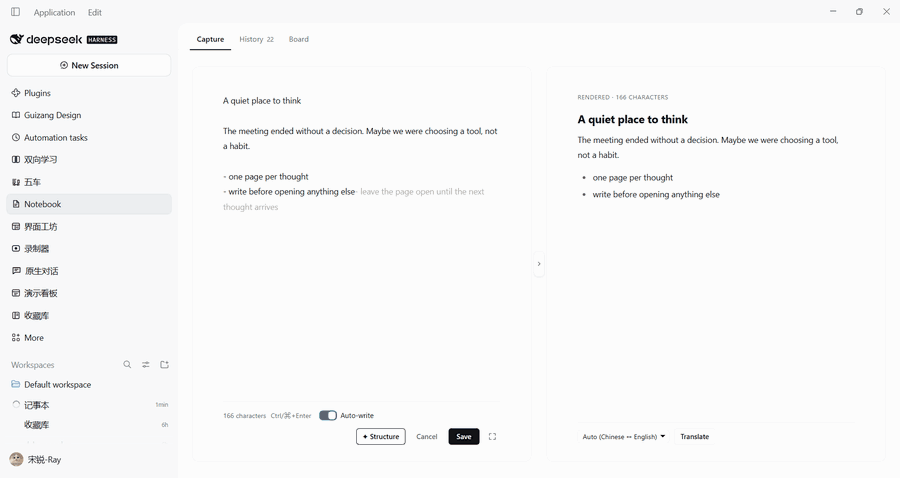
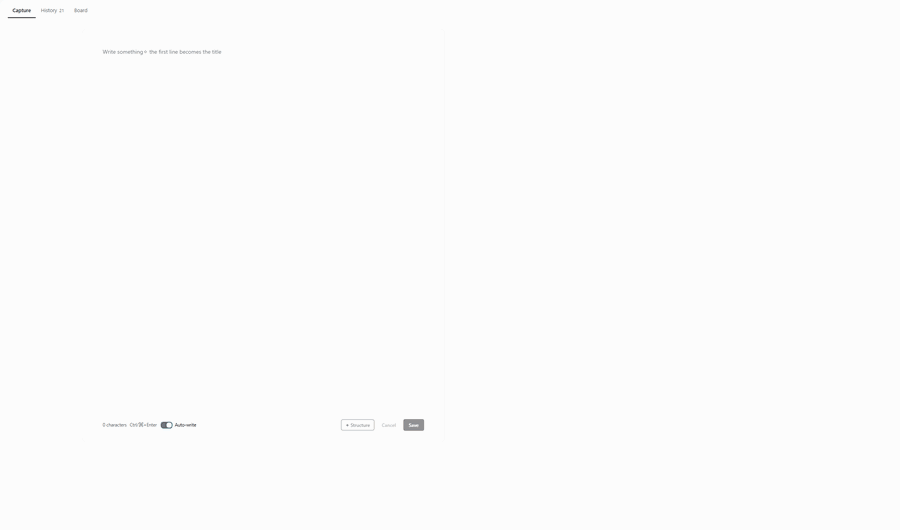
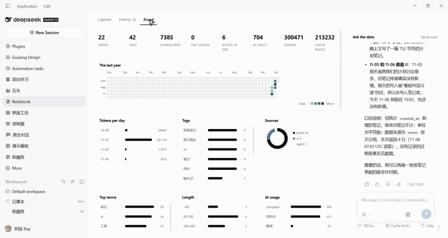
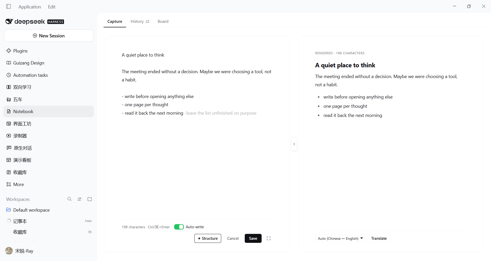
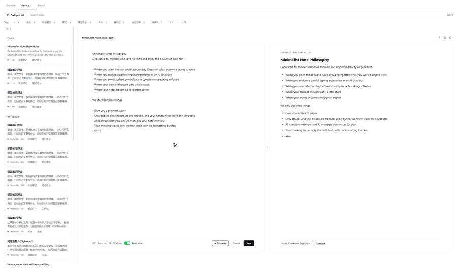
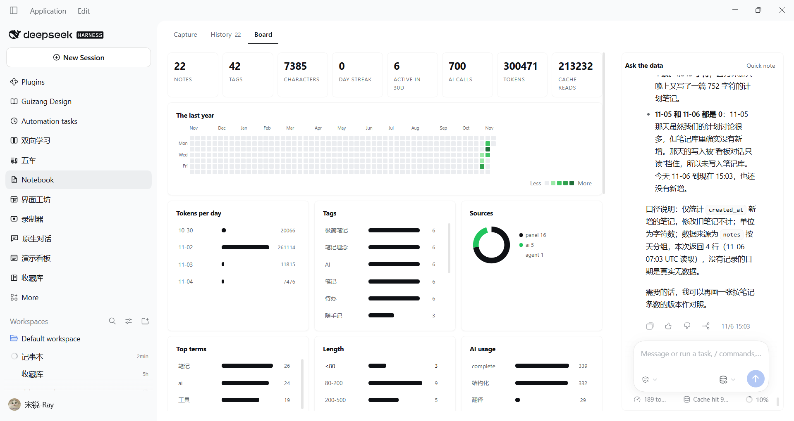

# dsh-notes

`@tyouter/dsh-notes` 1.1.2 — a notebook inside DeepSeek Harness, in three tabs. Type into one box,
read the typeset result beside it, and call the model only when judgement is needed. See
[CHANGELOG.md](CHANGELOG.md) for what the first official release contains.

## Install

The package is a DSH **bundle**: it carries the host half, the web panel and the agent presets it
needs, so one install is complete.

```powershell
dsh plugin --profile <name> add @tyouter/dsh-notes
```

Then add `@tyouter/dsh-notes` to `dsh.profile.bundles` in the profile's `package.json` if your
installer does not do it for you, and restart. The plugin appears in the sidebar and the plugin
inventory as **Notebook**.

From a checkout instead:

```powershell
git clone https://github.com/tyouter/dsh-notes.git
cd dsh-notes
npm run build          # writes client.js from src/
# then install the directory through Plugin Manager / install_bundle
```

Requirements: a DSH build with `node:sqlite` (Node 24 ships it). No other runtime dependency is
installed; everything under `lib/` is first-party.

## What it is for

献给：喜欢思考，享受纯净文字美感的思想者。当你打开工具后，已经忘记了要写什么；当你在 AI 对话框里忍受着痛苦的打字体验时；当你用复杂的笔记软件被工具栏干扰时；当你的思路有一些卡壳时；当你的笔记成为一个被遗忘的角落。我们只做三件事：给你一张纸，只需要用空格和换行，手不离开键盘；AI 随时相伴，你的笔记 AI 替你管理；让文字回到它本来的样子，干净、直接、不被打断。
- **Capture** — one box and one live page. Two spaces make a bullet, four the next level; Enter continues,
  Backspace backs out. A pause brings a suggestion (the note's own wording first), TAB takes a chunk, one
  Backspace gives it back. `Auto-write` turns suggestions — and their cost — off.
- **Structure and Translate** — rewrite the whole note or only the selection into a draft on the right
  page; the note changes only on **Apply**. Translate it into any language from the picker.
- **History** — search and tag-filter, a resizable list, and **Edit** that mounts the same two pages.
  **Copy** puts the note on the clipboard as standard Markdown (`#` title, `1.` numbering, `-` bullets).
- **Board** — a real agent session over the notebook: it answers with `notes_query` / `notes_analyze` and
  pins what it builds with `dashboard_chart`. The numbers come from the notes, not from the model.

### Three clips

| Capture | History | Board |
| --- | --- | --- |
|  |  |  |

### Three stills

| Capture | History | Board |
| --- | --- | --- |
|  |  |  |

## What it stores, and what leaves the machine

- Notes are plain JSON files under `notes-vault/` in the workspace (configurable with `notesPath`),
  plus a disposable SQLite projection rebuilt from them. Deleting the database loses nothing.
- Nothing is uploaded. Model calls go through the host's own `llm` service, so they use whatever
  provider and key the rest of DSH already uses.
- The board's assistant is a real agent session limited to the notebook's read-only query tools,
  `notes_analyze`, `dashboard_chart` and the note-writing `notes` tool.

| Tab | What it is |
| --- | --- |
| Capture | One box, two pages. The right page is Format, running live on every keystroke; the toolbar's **Structure** button adds an AI rewrite beside it. |
| History | The grouped history: two-line cards, a draggable list column, Markdown rendering, search and tags. **Edit mounts the capture box** — source on the left, the laid-out result on the right — so there is one editor, not two. |
| Board | Statistics over the notebook and its usage, plus the host's **native conversation** running the `notes-board` agent preset. |

### The four actions

| Action | Input | Lands in | Changes language |
| --- | --- | --- | --- |
| **Format** | the note, always | right page, live (no request, no button) | no |
| **Structure** | the note; the selection when there is one | an AI draft on the right page (Apply / Save / Translate) | never |
| **Translate** | the AI draft in place, **or** the note itself (selection, else whole) from the live preview | a draft edit / a proposal with Apply | yes |
| **Apply** | draft or proposal | back into the source, replacing only the range | — |

Format is deterministic (`formatLocally`), which is why it needs no button and no
model: separators, numbering, blank lines and stray stars are normalised, wording is
never touched, and the pass is idempotent. Saving a note writes the laid-out text, so
the right page is a promise rather than a hint. A selection in the editor highlights
the same lines in the preview; translate then works on that span.

Capture also works outside the panel: `Alt+N` or the small notebook icon in the
composer tool row opens a floating capture card, and `/note 内容` saves a note
straight from the chat box.

## Where notes live

`notes.json` is the source of truth: human-readable, diffable, and safe under
OneDrive. Everything else is derived.

```
<workspace>/notes-vault/
  notes.json      live notes (source of truth)
  trash.json      deleted notes, kept as a safety net
  links.json      which session belongs to the notebook
  events.jsonl    append-only instrumentation: AI calls, UI actions, charts
  dashboard.json  charts pinned to the dashboard
  index.db        SQLite projection of the above, for the query tools
```

`notesPath` in `cordis.patch.yml` changes the directory; a relative path anchors
on the **default workspace from the registry**, not on whichever session calls
first.

## Three AI surfaces, three different mechanisms

The distinction matters, and getting it wrong is what made an earlier version
send a truncated text dump into a prompt.

1. **Structuring** (`/notes/api/enhance/stream`) — a single streamed model call.
   No session, no tools. `start`, `delta`…, `done` with `{title, body, tags}`.
   Reasoning effort is set to `off`; measured ≈0.5 s to first token.
2. **Completion** (`/notes/api/complete`) — the next sentence, asked for only after typing
   stops for a second; the note's own repeated wording answers without a request.
3. **The dashboard chat** — a **real agent session** on the `notes-board` preset,
   rendered with the host's own Conversation component. It has tools, so it
   queries instead of guessing:

   | Tool | What it does |
   | --- | --- |
   | `notes_query` | one guarded `SELECT` against `index.db` (read-only, single statement, ≤500 rows, `?` params) |
   | `notes_analyze` | preset aggregates: `by_tag`, `by_source`, `by_day`, `by_hour`, `lengths`, `terms`, `ai_usage`, `timeline` |
   | `dashboard_chart` | add/replace a pinned chart on the dashboard |
   | `notes` | read and write the notes themselves |

   The panel only creates the session (`POST /notes/api/session/create`) and
   renders it. Delivery, streaming, tool cards and approvals are the framework's:
   the user types into the native composer, so no turn is ever pushed by hand.

## The database

`lib/db.js` maintains a SQLite projection (`index.db`) with four tables:

| Table | Contents |
| --- | --- |
| `notes` | one row per note, `body` is the full text |
| `note_tags` | one row per (note, tag), so tags are a `GROUP BY` |
| `events` | every AI call and UI action, with latency and outcome |
| `messages` | the dashboard conversation transcript, keyed by `(session_id, seq)` |

Two rules keep it honest:

- **It is disposable.** Delete `index.db` and it rebuilds from the JSON on the
  next read. A cache must never hold data the files do not.
- **It opens lazily and closes with the plugin.** Windows locks an open database
  file, so the disposer releases it before the directory could be moved.

`node:sqlite` ships with the app's own runtime (Node 24). If it is ever missing,
the query tools disable themselves and say so; the rest of the notebook works.

## Instrumentation

Every AI call appends one line to `events.jsonl` — kind, characters, elapsed time,
time to first token, success. UI beacons (`POST /notes/api/event`) record what the
user did: tab switches, note opens, AI calls, chart removals. The dashboard
conversation is ingested into `messages` on each poll, keyed by sequence number so
re-reading is idempotent.

That is what the 「AI 使用」tile and the average-first-token figure come from, and
what lets the assistant answer "what did I ask you last week".

## Files

| File | Role |
| --- | --- |
| `index.js` | Host half: the `notes` service, tools, command, data plane. |
| `lib/store.js` | The notebook files: notes, trash, links, search. |
| `lib/db.js` | The SQLite projection and its guarded queries. |
| `lib/text.js` | Term extraction (non-overlapping CJK bigrams, English words). |
| `lib/analytics.js` | Pure statistics for the dashboard. |
| `lib/events.js` | The event log and the pinned-chart store. |
| `lib/llm.js` | Streamed model call, reasoning-effort selection, timing. |
| `lib/chat.js` | The translate stream (whole note or numbered lines). |
| `lib/prompt.js` | Prompts and parsers: structuring, translation. |
| `lib/tools.js` | Tool adapters: query, analyze, chart, notes, enhance. |
| `lib/api.js` | `/notes/api` routes, including the SSE streams. |
| `src/head.js` | Browser prologue: i18n, api helpers, formatting, Markdown, styles. |
| `src/board.js` | Dashboard: chart renderers, statistics view, and the editor behaviours (spaces, Backspace, completion). |
| `src/panel.js` | Panel: tabs, capture, history, session shell, mount points. |
| `build.mjs` | Concatenates the three sources into `client.js`. |
| `tools/check-sources.mjs` | Parses the browser sources the way `build.mjs` wraps them. |
| `tools/fix-encoding.mjs` | Repairs a CJK string written through a byte-mangling pipeline. |
| `test/host.mjs` | Store, prompts, event log, chart store, tool adapters. |
| `test/prompts.mjs` | Structuring and completion prompts, term extraction. |
| `test/api.mjs` | The whole data plane in-process, including both SSE streams. |
| `test/render.mjs` | Slot wiring, tabs, dashboard, history editor and completion wiring. |
| `test/markdown.mjs` | Markdown rendering, snippets, tags, the drawer switch. |

## Working on it

This directory is its own git repository; the first commit is the baseline the
rest of the work is measured against.

```powershell
node tools/check-sources.mjs     # syntax check for the factory-bodied sources
node build.mjs                   # src/*.js -> client.js
node --check client.js
node tools/fix-encoding.mjs      # repair double-encoded CJK (only after a bad write)
```

The suites, in the order they are usually run:

| Suite | What it covers |
| --- | --- |
| `test/host.mjs` | store, analytics, API routing |
| `test/prompts.mjs` | structuring prompt, Markdown parsing, title rules |
| `test/api.mjs` | routes end to end with a fake model |
| `test/render.mjs` | component trees (Capture, History, Board) |
| `test/markdown.mjs` | rendering, snippets, tags, outline markers |
| `test/document.mjs` | whole documents: coverage repair, index-aligned assembly, typography gate |
| `test/typing.mjs` | the 极简写 keyboard flows, simulated slowly: spaces, nesting, Backspace |
| `test/layout.mjs` | dock layout contract + a preview page for the composer pinning |
| `test/corpus.mjs` | live run against the app: 17 inputs → structure → render → translate |

`client.js` is generated from `src/` by `build.mjs`. It **is** committed, because the host loads it
as the package's `./client` export: a fresh clone therefore works without a build step, and
`npm run build` is only needed after editing `src/`. `prepare`/`prepack` rebuild it on install and
publish. `exports/` holds generated previews and is ignored.

## License

MIT — see [LICENSE](LICENSE).

## Notes for maintainers

- Edit `src/`, then `node build.mjs`. `node --check src/panel.js` fails by design
  (the files are factory bodies); use `node tools/check-sources.mjs`.
- **`STYLES` and the i18n dictionaries live in a template literal.** A backtick in
  a CSS comment, or a `${` in prose, silently truncates the string.
- **Never rewrite these files through PowerShell text pipelines.** `Get-Content
  -Raw` reads them as ANSI and `Set-Content` writes UTF-8, which double-encodes
  every CJK string. Use the file tools, or Node with explicit UTF-8.
- No `Config` export: a profile-installed bundle resolves only its own
  dependencies, so no schema library is imported.
- Optional services (`commands`, `webServer`, `layout`, `llm`,
  `agentDefaultModel`, `sessionController`, `sessions`) are read through
  `ctx.get(...)`, never `ctx.<name>`: cordis throws on an undeclared property read.
- The panel declares a `notes.board.conversation` child slot; that declaration is
  what makes the framework inject `SessionProvider` + `renderSlot`.
- The shell strips a slot `children` array before rendering the panel.
- A key like `notes` is used by both the sidebar icon and the main panel; select
  the panel by slot name in tests, not by key.
- Every visible style is a `--dsw-alias-*` token; literal colors appear only in
  `icon.svg`… with one deliberate exception: the contribution matrix uses GitHub's
  exact five-step green ramp (`--dshn-heat-0..4`, with GitHub's dark variant under
  `prefers-color-scheme: dark`). Opacity over an accent colour cannot reproduce
  that ramp, and matching it is the point — so it is pinned, in one place, and
  named here rather than hidden.

## The contribution matrix

One column per week, one cell per day, a year of days. Intensity is quantised by
**quartiles of the non-zero counts**, as GitHub does, not by a ratio to the peak:
a notebook with one note a day therefore shows one light shade rather than
painting every day in the darkest green. The busiest day is always the darkest.
`src/board.js` (Heatmap) draws it; `lib/analytics.js` (`calendarYear`) supplies a
Sunday-aligned series so the renderer needs no date arithmetic.
- **Host-side changes need an app restart**; client-side changes need a refresh.
